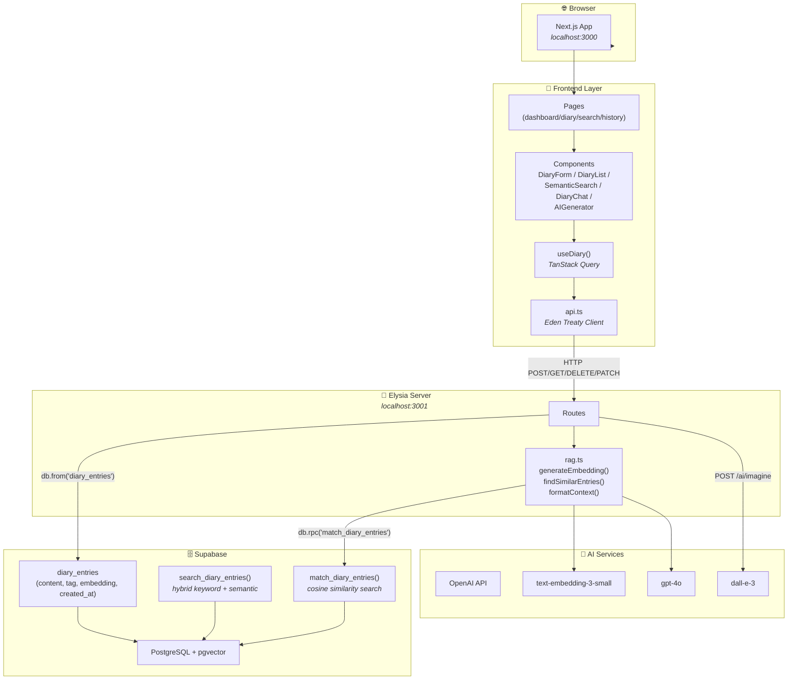
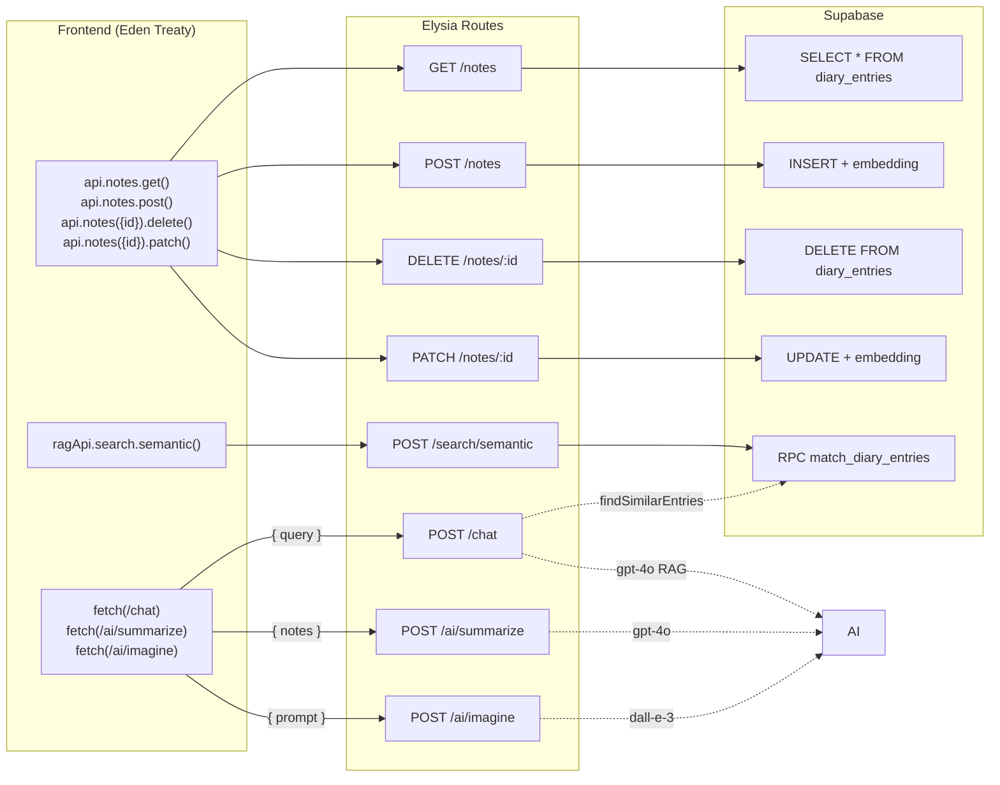
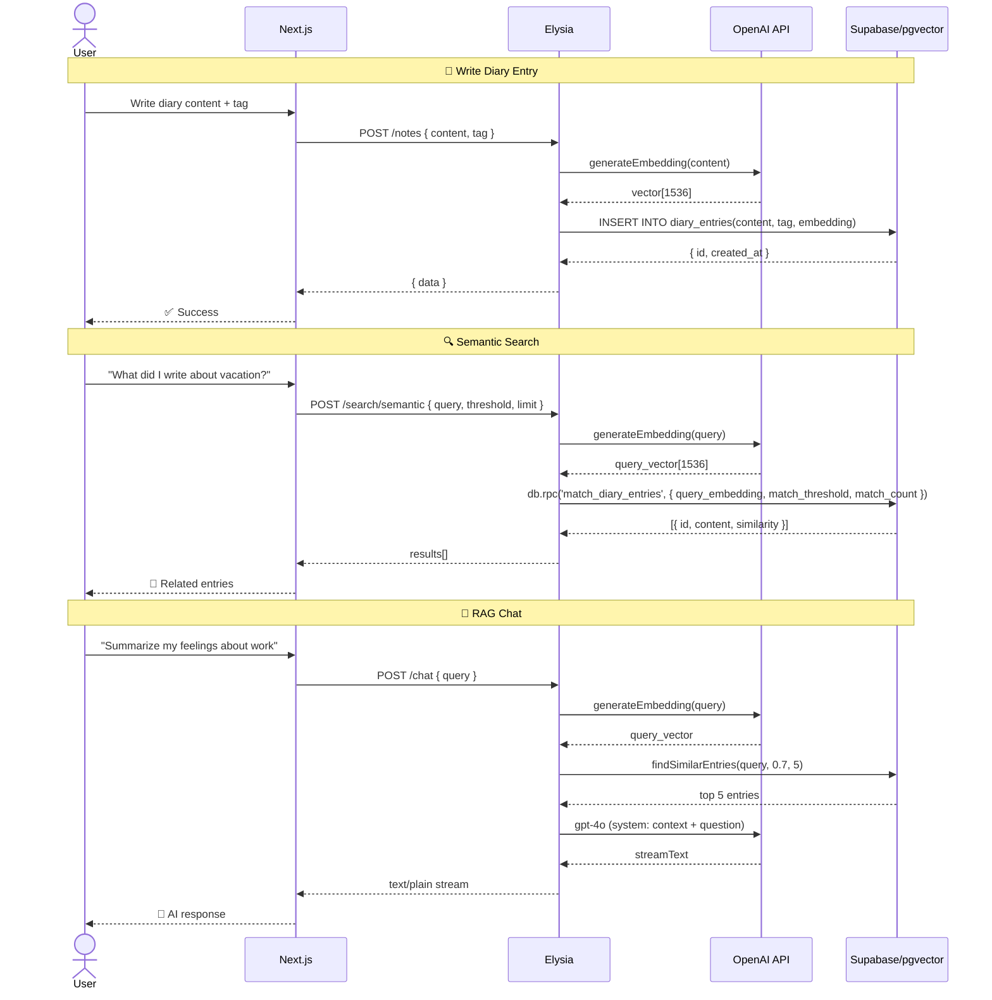

# RAG-Diary Architecture

> Auto-generated from code analysis (graphify + manual review) — 2026-06-08

---

## Stack Overview

```
Frontend     Next.js 16 (App Router) + React 19 + TypeScript 5 + Tailwind 4
State        TanStack React Query v5
Client API   Elysia Eden Treaty (type-safe HTTP client)
Server       Elysia v1 (Bun runtime) + TypeScript
Database     Supabase (PostgreSQL 15 + pgvector)
AI/ML        OpenAI: text-embedding-3-small, gpt-4o, dall-e-3
Auth         Supabase Auth (email/password) + Row Level Security per user
```

---

## Directory Layout

```
RAG-Diary/
├── server/                          # Elysia backend (Bun)
│   ├── package.json
│   ├── .env                         # SUPABASE_URL, SUPABASE_*KEY, OPENAI_API_KEY
│   └── src/
│       ├── index.ts                 # ★ Monolithic server entry — ALL routes & logic
│       ├── client.ts                # (unused stub)
│       └── lib/
│           ├── db.ts                # Supabase client init (service_role || anon)
│           └── schema.sql           # pgvector + diary_entries + match/search functions
│       └── modules/
│           └── ai/
│               └── rag.ts           # generateEmbedding, findSimilarEntries, formatContext
│           ├── notes/note.ts        # EMPTY
│           └── user/
│               ├── auth.ts          # EMPTY
│               └── user.ts          # EMPTY
│
├── frontend/                        # Next.js client
│   ├── package.json
│   ├── next.config.ts
│   ├── postcss.config.mjs
│   ├── eslint.config.mjs
│   └── app/
│       ├── layout.tsx               # Root layout: Geist font + <Providers>
│       ├── globals.css
│       └── (auth)/
│       │   ├── login/page.tsx       # Placeholder: "<div>LoginPage</div>"
│       │   └── register/page.tsx    # Placeholder: "<div>RegisterPage</div>"
│       └── (dashboard)/
│           ├── layout.tsx           # SidebarProvider + AppSidebar + children
│           ├── page.tsx             # Home — DiaryForm + DiaryList + AIGenerator
│           ├── diary/page.tsx       # Same as home (DiaryForm + DiaryList + AIGenerator)
│           ├── search/page.tsx      # SemanticSearch + DiaryChat
│           ├── historyBoard/page.tsx# DiaryList only
│           ├── favorite/page.tsx    # Placeholder: "<div>FavoritePage</div>"
│           ├── setting/page.tsx     # Placeholder: "<div>SettingPage</div>"
│           └── user/page.tsx        # Placeholder: "<div>UserPage</div>"
│   └── src/
│       ├── lib/
│       │   ├── api.ts               # Eden treaty client + postChatPlainText + ragApi
│       │   └── hooks/useDiary.ts    # TanStack Query: entries CRUD + semanticSearch + chat
│       ├── types/diary.ts           # DiaryEntry, SearchResult, ChatMessage interfaces
│       ├── utils/
│       │   ├── providers.tsx        # QueryClientProvider wrapper
│       │   └── utils.ts             # cn() — Tailwind class merge utility
│       ├── hooks/use-mobile.ts      # useIsMobile() hook
│       └── components/
│           ├── sidebar/app-sidebar.tsx   # Nav: Home, Search, History, Favorite, User, Setting
│           ├── diary/
│           │   ├── diaryForm.tsx         # Create entry form (content + tag selector)
│           │   ├── diaryList.tsx         # List entries + edit/delete
│           │   ├── SemanticSearch.tsx    # Semantic search by natural language
│           │   └── DiaryChat.tsx         # RAG chat with entries
│           ├── aiGenerator/
│           │   └── AIGenerator.tsx       # Summarize + DALL-E image generation
│           └── ui/                       # shadcn-style primitives
│               ├── sidebar.tsx, button.tsx, input.tsx, sheet.tsx
│               ├── separator.tsx, skeleton.tsx, tooltip.tsx
│               └── ...
│
└── docs/ (.md)                     # Course notes, project overview, implementation summary
    ├── RAG-DIARY-COURSE.md
    ├── PROJECT_OVERVIEW.md
    ├── IMPLEMENTATION_SUMMARY.md
    └── README.md (×3: root, frontend, server)
```

---

## Data Flow



---

## API Routes



---

## RAG Pipeline (End-to-End)



---

## Database Schema

```sql
-- Table: diary_entries
CREATE TABLE diary_entries (
    id         UUID PRIMARY KEY DEFAULT gen_random_uuid(),
    content    TEXT NOT NULL,
    tag        TEXT,                          -- 'General', 'Work', 'Idea', 'Feeling'
    created_at TIMESTAMPTZ DEFAULT now(),
    embedding  VECTOR(1536)                   -- OpenAI text-embedding-3-small
);

-- Index: HNSW for fast approximate nearest-neighbor search
CREATE INDEX diary_entries_embedding_idx
    ON diary_entries
    USING hnsw (embedding vector_cosine_ops);

-- Function: match_diary_entries (pure vector similarity)
CREATE FUNCTION match_diary_entries(
    query_embedding VECTOR(1536),
    match_threshold FLOAT,
    match_count     INT
) RETURNS TABLE (
    id         UUID,
    content    TEXT,
    tag        TEXT,
    created_at TIMESTAMPTZ,
    similarity FLOAT
) LANGUAGE sql STABLE AS $$
    SELECT
        id, content, tag, created_at,
        1 - (embedding <=> query_embedding) AS similarity
    FROM diary_entries
    WHERE embedding <=> query_embedding < 1 - match_threshold
    ORDER BY embedding <=> query_embedding
    LIMIT match_count;
$$;

-- Function: search_diary_entries (hybrid keyword + vector)
CREATE FUNCTION search_diary_entries(
    query_text      TEXT,
    query_embedding VECTOR(1536),
    match_limit     INT,
    keyword_weight  FLOAT,
    semantic_weight FLOAT
) RETURNS TABLE (...) LANGUAGE sql STABLE AS $$
    SELECT ...
    ORDER BY (
        keyword_weight * ts_rank(to_tsvector('english', content), plainto_tsquery('english', query_text)) +
        semantic_weight * (1 - (embedding <=> query_embedding))
    ) DESC
    LIMIT match_limit;
$$;
```

---

## Page Routing Map

| Path | Component(s) | Status |
|------|-------------|--------|
| `/` (index) | DiaryForm + DiaryList + AIGenerator | ✅ ใช้งานได้ |
| `/diary` | DiaryForm + DiaryList + AIGenerator | ✅ (ซ้ำกับ `/`) |
| `/search` | SemanticSearch + DiaryChat | ✅ ใช้งานได้ |
| `/historyBoard` | DiaryList | ✅ ใช้งานได้ |
| `/favorite` | Placeholder | ⏳ ยังไม่ทำ |
| `/setting` | Placeholder | ⏳ ยังไม่ทำ |
| `/user` | Placeholder | ⏳ ยังไม่ทำ |
| `/login` | Placeholder | ⏳ ยังไม่ทำ |
| `/register` | Placeholder | ⏳ ยังไม่ทำ |

---

## Architectural Observations

### ✅ สิ่งที่ทำได้ดี
- **Eden Treaty** ให้ type safety ข้าม client-server โดยตรง
- **TanStack Query** จัดการ cache + refetch ได้ดี
- **pgvector HNSW index** ทำให้ semantic search เร็ว
- **Hybrid search function** พร้อมรองรับทั้ง keyword + semantic

### ⚠️ จุดที่ควรปรับปรุง
1. **Monolithic server** — `index.ts` (182 บรรทัด) รวม CRUD + AI + RAG ไว้หมด — ควรแยก modules
2. **Auth ยังไม่ทำ** — login/register/setting/user/favorite เป็น placeholder
3. **3 server modules ว่าง** — `note.ts`, `auth.ts`, `user.ts` ไม่มีโค้ด
4. **Error handling ซ้ำ** — ทุก route มี try-catch pattern ซ้ำกัน
5. **Route `/diary` ซ้ำกับ `/`** — ใช้ components ชุดเดียวกัน

### 🧭 Suggested Next Steps
1. [ ] Implement Supabase Auth + login/register pages
2. [ ] Refactor `index.ts` → split into `modules/notes/routes.ts`, `modules/ai/routes.ts`, `modules/user/routes.ts`
3. [ ] Implement Favorite, Setting, User pages
4. [ ] Add error middleware (Elysia `.onError()`)
5. [ ] Add request validation with Elysia schema (partially done)
6. [ ] Write tests (Vitest for server, Testing Library for frontend)
